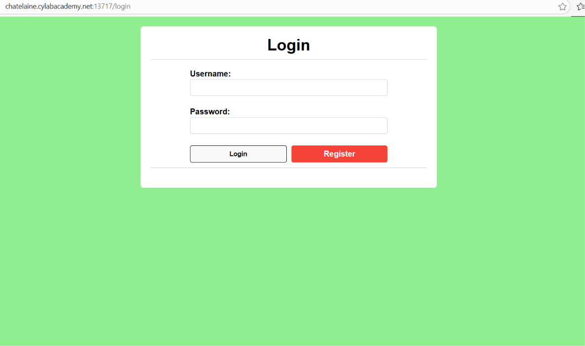
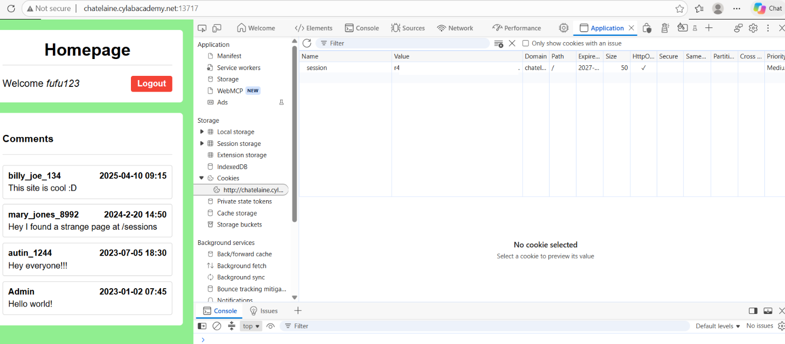
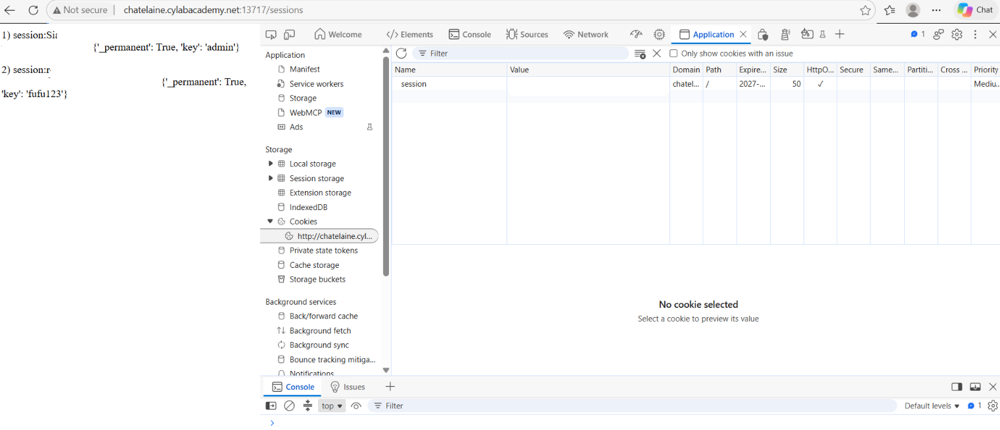
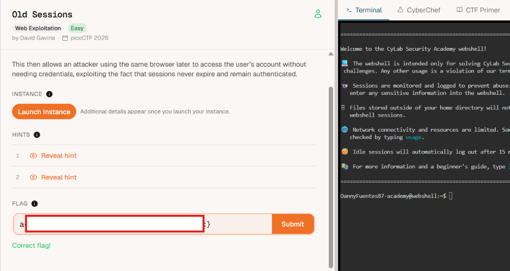
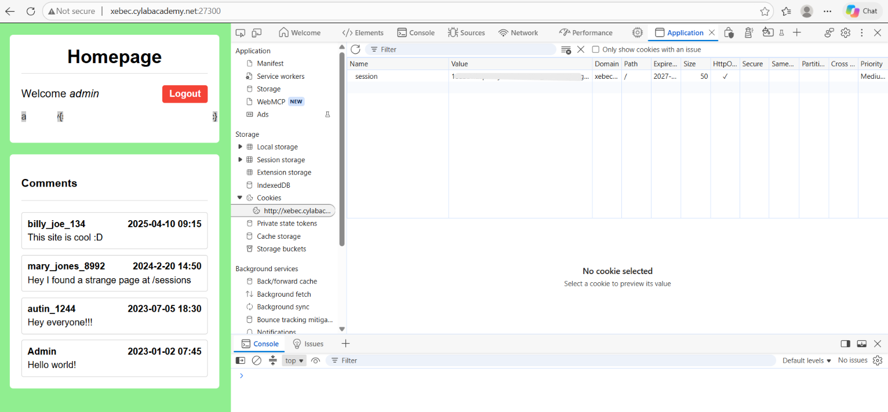

# picoCTF 2026 — Old Sessions

**Category:** Web Exploitation  
**Difficulty:** Easy  
**Status:** Completed

## Objective

Investigate a vulnerable web application to identify weaknesses in session management and demonstrate how exposed session identifiers can lead to unauthorized access.

## Tools Used

- Microsoft Edge Developer Tools
- Browser Cookie Inspector
- picoCTF Web Application Lab

## Investigation and Methodology

### 1. Reconnaissance

I launched the challenge and registered a test account. After logging in, I used Developer Tools to inspect how the application stored authentication cookies.

### 2. Endpoint Discovery

While examining the homepage, I discovered a comment referencing a `/sessions` endpoint.

Navigating to this endpoint revealed session identifiers associated with different accounts, including an administrator.

### 3. Session Analysis

I inspected the browser's `session` cookie and compared its value with the exposed administrator session identifier.

### 4. Exploitation

Within the authorized CTF environment, I replaced my session cookie with the exposed administrator session identifier.

My initial attempt failed because I accidentally included a comma at the end of the identifier. After correcting the formatting, the application accepted the session and granted administrator access.

### 5. Results
Successfully completed the challenge and retrieved the flag.

## Lab Screenshots

### Initial Login Page

### Authentication Cookie Inspection

### Exposed Sessions Endpoint

### Flag Submitted

### Successful Administrator Session

**Figure 5:** Successful administrator authentication
after replacing the original session cookie with an
exposed administrator session identifier. Sensitive
authentication information has been redacted.

## Vulnerability Identified

**Session Hijacking Through Exposed Authentication Tokens**

The application exposed valid session identifiers, allowing an unauthorized user to impersonate another account.

## Security Recommendations

- Restrict access to session-management endpoints.
- Never expose active authentication tokens.
- Implement proper server-side session expiration.
- Invalidate authentication sessions when users log out.
- Monitor suspicious authentication and session activity.

## Lessons Learned

This challenge strengthened my understanding of web authentication, browser cookies, and session management.

I also learned the importance of precision when working with authentication tokens. A single additional character caused authentication to fail.

## Skills Demonstrated

- Web application security
- Browser Developer Tools
- Cookie inspection
- Session hijacking
- Vulnerability identification
- Technical troubleshooting
- Security documentation

---

*Completed in an authorized picoCTF training environment for educational purposes.*
